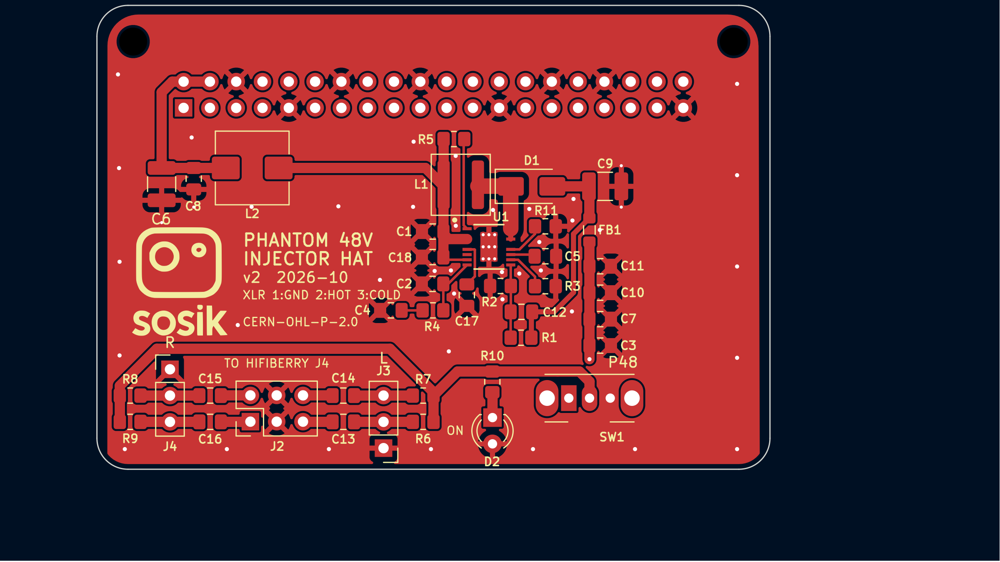
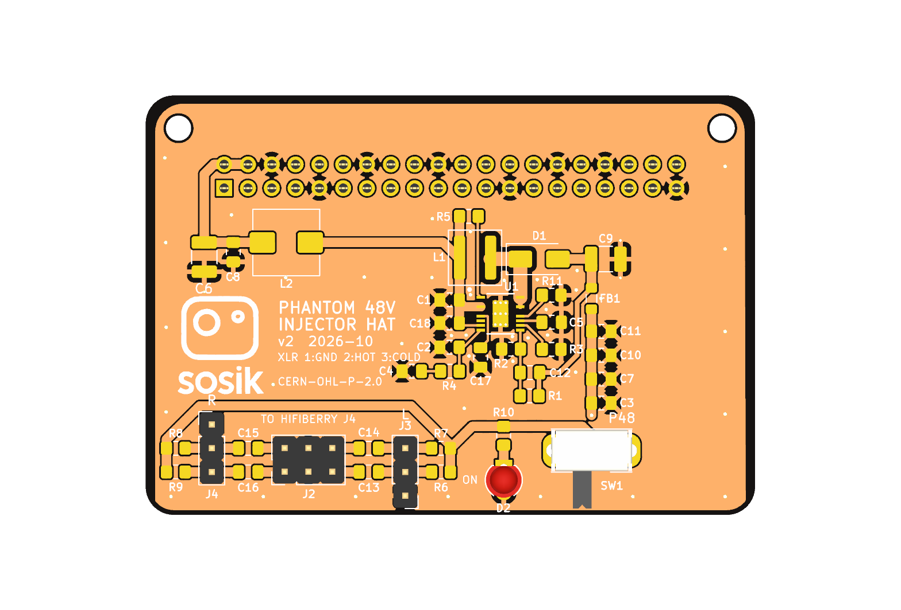
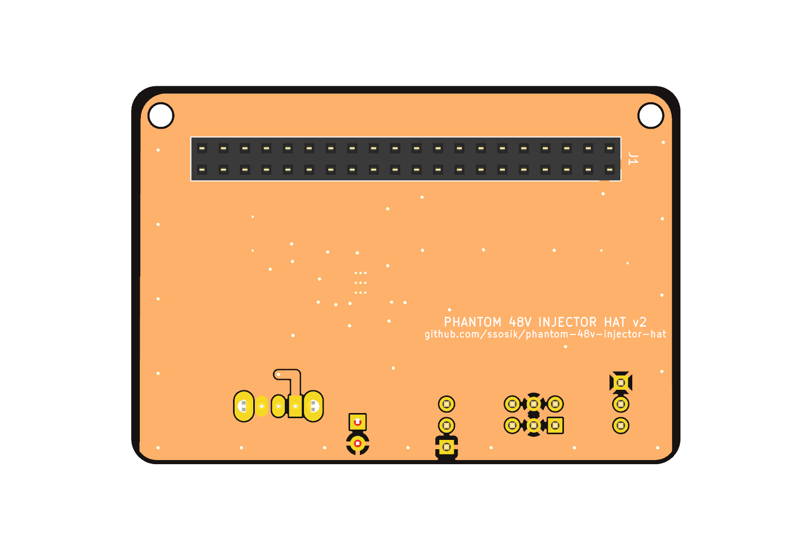

# Phantom 48V Injector HAT

A Raspberry Pi add-on board that generates **+48V phantom power** from the Pi's 5V GPIO rail and
injects it onto two balanced microphone lines feeding a **HiFiBerry DAC2 ADC Pro**. It was designed
for a stereo wildlife-recording rig (Pi 4B + HiFiBerry + ESP P93 preamps with Primo EM272 capsules)
but works for any pair of P48 mics into that ADC.



| Top (3D render) | Bottom (3D render) |
|---|---|
|  |  |

> **Status: v2 (2026-10-29). Design complete, not yet fabricated or tested.** Read
> [Known issues](#known-issues) before ordering boards: items 1–3 are open design questions.

## Specs

| | |
|---|---|
| Input | 5V from Pi GPIO pins 2/4, through a π input filter (C6/C8 – L2 – C1) |
| Converter | Analog Devices LT8362 boost, 404 kHz, Burst + spread-spectrum (SSFM) mode |
| Output | 47.6 V typ (46.0–49.3 V worst case), within IEC 61938 P48 (48 V ± 4 V) |
| Load budget | 16 mA at 48 V → ~185 mA from the Pi 5V rail |
| Injection | 6.81 kΩ 0.1% per leg, 2 channels, one SPDT switch for both, green LED indicator |
| DC block | 2.2 µF / 100 V X7R per leg (~15 Hz corner after DC-bias derating) |
| Connectors | J1 2×20 GPIO socket (bottom side), J2 2×3 to HiFiBerry J4, J3/J4 1×3 XLR pigtails |
| Board | 65 × 45 mm, 2-layer, 2× M2.5 mounting holes, all SMD passives 0805 or larger |

```
Pi 5V ─► π filter ─► LT8362 boost ─► FB1 + output caps ─► SW1 ─► 6.81k ×4 ─► XLR pins 2/3 (J3, J4)
                                                                                  │
                                                     HiFiBerry J4 (J2) ◄─ 2.2µF ×4 ┘
```

See [DESIGN_DOC.md](DESIGN_DOC.md) for the full rationale: why it's non-isolated, why 400 kHz,
resistor matching and CMRR, layout strategy, and hand-assembly and first-power procedures.

## Known issues

Items 1–3 are deferred design questions. Resolve them before fabrication.

1. **Phantom switching transients reach the HiFiBerry inputs.** The DC-block caps C13–C16
   start uncharged. When SW1 switches phantom on, the ADC side of each cap jumps with the line
   side. A rough estimate (6.81 kΩ feed into the PCM1863's ~8 kΩ input) gives about +26 V
   common-mode at the input pins, decaying with τ ≈ 30 ms. Switching off gives the mirror image
   (≈ −26 V); the active drain to GND doesn't prevent it. Typical mic-preamp phantom inputs put
   clamp diodes and a series resistor after the DC-block cap for this reason. Whether the
   HiFiBerry DAC2 ADC Pro already protects its inputs hasn't been checked. Until it is, switch
   phantom only with the ADC unpowered, or add a clamp per leg (series R + BAV99 to the rails,
   or a low-capacitance TVS). See PLAN #36.
2. **Stack order is undecided.** DESIGN_DOC says Pi → HiFiBerry → this HAT. PLAN #1 says
   Pi → this HAT → HiFiBerry. J1 is a bottom-side socket with no pass-through pins, so in the
   PLAN #1 order the HiFiBerry would get no GPIO (I²S/I²C). In the DESIGN_DOC order the J1 socket
   needs male pins on the HiFiBerry to mate with. Confirm the stack physically before ordering. See PLAN #37.
3. **J2 orientation.** J2 is a top-side vertical header (PLAN #7 asked for bottom side). If it
   connects to the HiFiBerry J4 through a 2×3 IDC ribbon, the ribbon swaps the odd and even rows.
   Check the pin-1 mapping end to end, since this is the only thing keeping L/R polarity right. See PLAN #38.
4. **LT8362 footprint library lives outside the repo.** `fp-lib-table` points at
   `../ul_LT8362EMSE-PBF/`, an Ultra Librarian download that isn't redistributed here. The
   footprint is embedded in the `.kicad_pcb`, so the board opens and DRCs fine. *Update PCB
   from Schematic* needs the library: get it from Ultra Librarian or analog.com, or retarget
   U1 to the embedded footprint.
5. **Schematic is label-only.** Connectivity is generated by `wire_schematic.py` as net labels
   on unwired symbols. It is correct (ERC 0 errors), and v2 hides the footprint, datasheet and
   description fields, but it still reads as a parts list rather than a circuit diagram.
6. **SW1 slide direction isn't marked.** The silkscreen labels the switch "P48" and the LED
   "ON" rather than marking ON/OFF ends, because which slider position connects the
   common to pin 1 hasn't been verified against the C&K datasheet.

## Repository layout

| Path | What |
|---|---|
| `phantom-injector-hat.kicad_pro/.kicad_sch/.kicad_pcb` | KiCad 10 project |
| `phantom-injector-hat.kicad_dru` | Custom DRC rules (MSOP-16 clearance, power widths, SW-node isolation) |
| `BOM.csv` | Authoritative BOM with manufacturer and DigiKey part numbers |
| `digikey-order-5units.csv` | DigiKey bulk-order upload for 5 boards (+ spares) |
| `DESIGN_DOC.md` | Architecture, BOM rationale, netlist, layout and assembly notes |
| `PLAN.md` | Numbered design-review log (✅ = closed) |
| `ROUTING_GUIDE.md` | Pre-routing guide: trace widths per net, loop priorities |
| `TESTS.md` | How to run DRC/ERC/netlist checks and the simulations |
| `wire_schematic.py` | Generates schematic net labels from a Python `NETLIST` dict |
| `place_components.py` | Places PCB footprints from a `PLACEMENTS` dict |
| `check_netlist.py` + `netlist_golden.json` | Detects PCB net drift against a saved golden |
| `sims/` | ngspice decks and stdlib-Python models (boost, input filter, audio path) |
| `phantom-injector-hat.pretty/` | Project footprint library (`Logo_Sosik` silkscreen logo) |
| `logo.kicad_sym` | Logo as a schematic symbol (source for the footprint) |
| `DRC.rpt`, `ERC.rpt` | Latest check reports |

`phantom-injector-hat-BOM.xlsx` is an early (2026-05-12) BOM snapshot. Use `BOM.csv`.

## Working with the project

Requires KiCad 10. The Python scripts need KiCad's bundled interpreter, which provides `pcbnew`.
The paths below are for macOS:

```bash
KPY=/Applications/KiCad/KiCad.app/Contents/Frameworks/Python.framework/Versions/3.9/bin/python3
KCLI=/Applications/KiCad/KiCad.app/Contents/MacOS/kicad-cli

$KCLI pcb drc --format report --all-track-errors -o DRC.rpt phantom-injector-hat.kicad_pcb
$KCLI sch erc -o ERC.rpt phantom-injector-hat.kicad_sch
$KPY check_netlist.py
```

Current baseline: DRC 0 unconnected, 1 documented `track_width` exception; ERC 0 errors and
13 warnings, all from the vendor symbol's pin types. See [TESTS.md](TESTS.md).

## Ordering and assembly

- `BOM.csv` is the source of truth. L1 (Coilcraft XAL5050-223MEC) isn't stocked at DigiKey;
  order it from coilcraft.com.
- DESIGN_DOC §5.8 covers hot-plate reflow (recommended), hot-air, and iron-only assembly, plus a
  current-limited first-power test sequence.

Datasheets (not committed, since they're vendor copyright):
- [LT8362, Analog Devices](https://www.analog.com/en/products/lt8362.html)
- [C&K OS102011MA1QN1 slide switch](https://www.digikey.com/en/products/detail/c-k/OS102011MA1QN1/1981430)
- [HiFiBerry DAC2 ADC Pro](https://www.hifiberry.com/docs/data-sheets/datasheet-dac2-adc-pro/)

## Safety

48 V phantom can damage some ribbon microphones and unbalanced sources. Switch phantom off before
connecting or disconnecting mics. The boost converter has no output short-circuit protection: in a
boost topology a shorted output pulls current from the Pi's 5V rail through L1 and D1.

## License

Copyright 2026 Steve Sosik. Hardware design files, documentation and scripts are licensed under the
[CERN Open Hardware Licence Version 2 – Permissive](LICENSE) (CERN-OHL-P-2.0).
